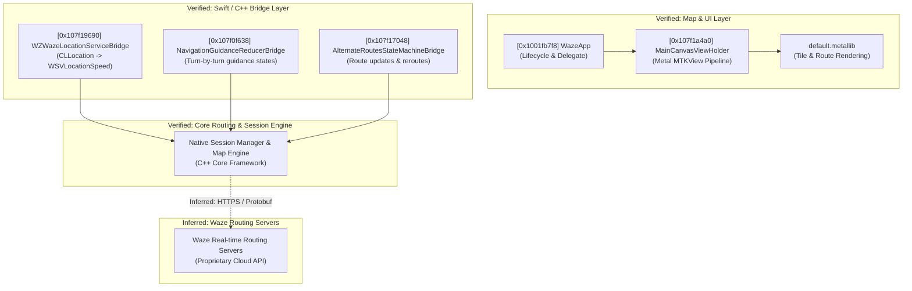

# Waze iOS Static Analysis & Architecture Research Reports

[-orange.svg)](#target-overview)

This repository contains static analysis documentation, architectural models, and tool verification records from an authorized, read-only reverse engineering audit of the Waze iOS application bundle (`waze.ipa`, v5.22.0).

The objective of this research is to evaluate static analysis feasibility, verify REA (Reverse Engineer Anything) and Ghidra toolchains against modern iOS production binaries, and document clean-room architectural boundaries without redistributing proprietary assets or source code.

---

## Target Overview

| Attribute | Verified Value |
|:---|:---|
| **Application Name** | Waze Navigation & Live Traffic |
| **Bundle Identifier** | `com.waze.iphone` |
| **Application Version** | `5.22.0` |
| **Target Architecture** | ARM64 (`arm64e` slice not present) |
| **Mach-O Type** | `MH_EXECUTE` (Mach-O 64-bit executable) |
| **Binary Size** | 141,407,824 bytes (~141.4 MB) |
| **SHA-256 Checksum** | `f6cbb731a5eb234789ba858c7e63b65a5078a08cfab86236b2890eeafcce7697` |
| **Minimum iOS Version** | iOS 15.0 |
| **DRM / Encryption Status** | `LC_ENCRYPTION_INFO_64` present with `cryptid = 0` (unencrypted) |
| **Total Mach-O Symbols** | 614,321 (`LC_SYMTAB`) |
| **Objective-C Classes** | 6,994 (`__objc_classlist`) |
| **Swift Reflection Records** | 19,404 type/field strings (`__swift5_reflstr`) |

---

## Repository Documentation Index

### 1. Research Reports (`reports/`)

- **[`01_ipa_structure.md`](reports/01_ipa_structure.md)**: IPA container layout, bundle metadata, Info.plist properties, Mach-O headers, segment mappings, background execution modes, and security entitlements.
- **[`02_analysis_assessment.md`](reports/02_analysis_assessment.md)**: REA 6.5.0 and Ghidra 12.1.2 operational evaluation, metadata extraction, toolchain limitations (including dot-path workarounds), and clean-room specification guidelines.
- **[`03_final_verification.md`](reports/03_final_verification.md)**: Structured verification answering all core evaluation criteria: binary identity, DRM status, headless Ghidra performance, Swift/Obj-C symbol recovery, and bridge interfaces.
- **[`04_main_binary_verification.md`](reports/04_main_binary_verification.md)**: In-depth technical verification of the 141.4 MB ARM64 main executable, Ghidra headless import metrics, sample decompilation validation (100% success on test batch), and procedure cross-references.
- **[`05_architecture_analysis.md`](reports/05_architecture_analysis.md)**: Structural synthesis of core subsystems: application entry & lifecycle (`WazeApp`), map canvas rendering (`MainCanvasViewHolder` & Metal shaders), route state management (`AlternateRoutesStateMachineBridge`), navigation guidance (`NavigationGuidanceReducerBridge`), and location tracking (`WZWazeLocationServiceBridge`).
- **[`06_reverse_feasibility.md`](reports/06_reverse_feasibility.md)**: Recovery assessment matrix (categorized into VERIFIED, PARTIALLY VERIFIED, UNKNOWN, and BLOCKED), identifying server-dependent boundaries and client-side replay feasibility.

### 2. Technical Evidence (`evidence/`)

- **[`function_inventory.md`](evidence/function_inventory.md)**: Formal register of audited functions, including virtual addresses, class bindings, cross-references, decompiled behavior summaries, and confidence levels.
- **[`class_inventory.md`](evidence/class_inventory.md)**: Register of critical Objective-C classes, internal class hierarchies, protocols, and internal Google monorepo source path references (`//maps/mobile/waze/...`).
- **[`analysis_statistics.md`](evidence/analysis_statistics.md)**: Quantitative static analysis metrics, section sizes, string distributions, symbol counts, and Ghidra headless processing benchmarks.
- **[`tool_verification.md`](evidence/tool_verification.md)**: Tool environment verification records for REA 6.5.0 MCP server, Ghidra 12.1.2 headless analyzer, LLVM 21.1.5 toolchain, and OpenJDK 27 on Arch Linux.

### 3. Architecture Diagrams (`diagrams/`)

- **[`architecture.md`](diagrams/architecture.md)**: Component diagrams (Mermaid format) depicting the high-level application architecture, map rendering pipeline, navigation data flow, and runtime lifecycle. All verified versus inferred relationships are explicitly labeled.

---

## Architectural Highlights

1. **Application Lifecycle**: The main entry point (`entry` at `0x1001fb7f8`) delegates directly to `WazeApp`, serving as both principal class and `UIApplicationDelegate`.
2. **Map Graphics Pipeline**: `MainCanvasViewHolder` manages an Apple Metal rendering pipeline (`createMetalViewController`, MTKView) backed by shaders embedded in `default.metallib`.
3. **Location Processing**: `WZWazeLocationServiceBridge` bridges iOS `CLLocation` callbacks to internal C++ structures (`WSVLocationSpeed`), translating latitude, longitude, altitude, course, and speed.
4. **Navigation Guidance**: `NavigationGuidanceReducerBridge` acts as a unidirectional state reducer, managing audio prompts, visual instruction cards, lane guidance, and ETA progress.
5. **Route Evaluation**: `AlternateRoutesStateMachineBridge` evaluates alternative paths, parses `CurrentRouteUpdate` / `RerouteSuggestion` payloads, and enforces server-directed update cadences (`NextUpdateSchedule`).

---

## Analysis Toolchain

| Tool | Version | Role / Usage |
|:---|:---|:---|
| **REA (Reverse Engineer Anything)** | 6.5.0 | MCP server static analysis, header inspection, and automated disassembly |
| **Ghidra** | 12.1.2 | Headless batch analysis, ARM64 decompilation, and cross-reference auditing |
| **LLVM / Clang** | 21.1.5 | `llvm-objdump`, `llvm-readelf`, `llvm-otool`, and `llvm-nm` |
| **Java Runtime** | OpenJDK 27 (Arch Linux) | Ghidra headless execution runtime |
| **Platform** | Arch Linux (x86_64, Linux 6.16) | Static analysis host environment |

---

## Research Scope & Security Boundary

In strict compliance with security standards, intellectual property laws, and ethical research guidelines:

- **No Application Binaries**: Neither `waze.ipa`, the extracted `.app` bundle, Mach-O executables (`Waze`, `SpotifyiOS`, `NotificationExtension`), compiled frameworks, nor asset catalogs (`Assets.car`, `default.metallib`) are included in this repository.
- **No Private Credentials**: No developer certificates, provisioning profiles, private signing keys, API tokens, or user data are stored or committed.
- **No Proprietary Decompilations**: Reports contain high-level architectural summaries, function interfaces, and behavioral descriptions rather than raw decompiled source code or proprietary reverse-engineered implementations.
- **Independent Clean-Room Research**: This documentation serves exclusively to enable peer review and technical auditing of static analysis capabilities on modern ARM64 iOS executables.
