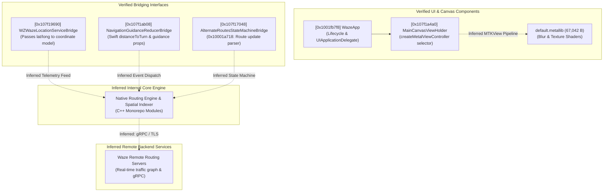

# Waze iOS Static Analysis & Architecture Research Reports

[-orange.svg)](#target-overview)

This repository contains static analysis documentation, architectural models, evidence inventories, and tool verification records from an authorized, read-only reverse engineering audit of the Waze iOS application bundle (`waze.ipa`, v5.22.0).

The objective of this research is to evaluate static analysis feasibility, verify REA (Reverse Engineer Anything) and Ghidra toolchains against modern iOS production binaries, and document clean-room architectural boundaries without redistributing proprietary assets or source code.

---

## Target Overview

| Attribute | Verified Value | Verification Method |
|:---|:---|:---|
| **Application Name** | Waze Navigation & Live Traffic | Extracted bundle display name |
| **Bundle Identifier** | `com.waze.iphone` | Verified in `Info.plist` |
| **Application Version** | `5.22.0` (Build `1`) | Verified in `Info.plist` |
| **Target Architecture** | ARM64 (`CPU_TYPE_ARM64`, Subtype `0`) | Mach-O 64-bit Header |
| **Mach-O Type** | `MH_EXECUTE` (Mach-O 64-bit executable) | Mach-O Header |
| **Binary Size** | **141,425,424 bytes** (~141.42 MB / 134.87 MiB) | Byte-exact file stat |
| **SHA-256 Checksum** | `0c40c247228439e2b75baca181569c75c144918561a8177e9399b183b5709d80` | SHA-256 computed on binary |
| **Mach-O UUID** | `4556fa71-0a76-3117-b160-07139913ce8d` | Mach-O `LC_UUID` load command |
| **Minimum iOS Version** | **iOS 16.0** (`MinimumOSVersion: 16.0`) | `Info.plist` target deployment |
| **DRM / Encryption Status** | `LC_ENCRYPTION_INFO_64` present with **`cryptid = 0`** (unencrypted) | Mach-O load command `0x2C` |
| **Raw Mach-O Symbols** | **5,098 symbols** (`LC_SYMTAB`: 5,096 imports, 1 defined, 1 local) | Mach-O symbol table (stripped release) |
| **Ghidra Database Labels** | **614,321 labels** (Ghidra internal symbol database) | Ghidra `SymbolTable.getAllSymbols()` |
| **Objective-C Classes** | 6,994 (`__objc_classname`) / 5,677 (`__objc_classlist`) | Section string/pointer count |
| **Swift Reflection Records** | 19,404 property/field strings (`__swift5_reflstr`) | Section string count |

---

## Repository Documentation Index

### 1. Research Reports (`reports/`)

- **[`01_ipa_structure.md`](reports/01_ipa_structure.md)**: IPA container layout, bundle metadata, Info.plist properties, Mach-O headers, segment mappings, background execution modes, and security entitlements.
- **[`02_analysis_assessment.md`](reports/02_analysis_assessment.md)**: REA 6.5.0 and Ghidra 12.1.2 operational evaluation, metadata extraction, toolchain limitations (including dot-path workarounds), and clean-room research guidelines.
- **[`03_final_verification.md`](reports/03_final_verification.md)**: Structured verification answering all core evaluation criteria: binary identity, DRM status, headless Ghidra performance, Swift/Obj-C symbol recovery, and bridge interfaces.
- **[`04_main_binary_verification.md`](reports/04_main_binary_verification.md)**: In-depth technical verification of the 141.42 MB ARM64 main executable, Ghidra headless import metrics, sample decompilation validation, and procedure cross-references.
- **[`05_architecture_analysis.md`](reports/05_architecture_analysis.md)**: Structural synthesis of core subsystems: application entry & lifecycle (`WazeApp`), map canvas rendering (`MainCanvasViewHolder` & Metal shaders), route state management (`AlternateRoutesStateMachineBridge`), navigation guidance (`NavigationGuidanceReducerBridge`), and location tracking (`WZWazeLocationServiceBridge`).
- **[`06_reverse_feasibility.md`](reports/06_reverse_feasibility.md)**: Recovery assessment matrix categorized into VERIFIED, PARTIALLY VERIFIED, INFERRED, and BLOCKED; identifies server-dependent boundaries, entitlement constraints, and copyright boundaries.
- **[`07_consistency_audit.md`](reports/07_consistency_audit.md)**: Comprehensive audit report reconciling all historical discrepancies (file size, SHA-256, iOS minimum version, symbol table definitions) against original ground truth artifacts.
- **[`08_targeted_core_analysis.md`](reports/08_targeted_core_analysis.md)**: Targeted ARM64 binary analysis and scoped decompilation verification of five non-trivial application routines (100% success rate, boundary validation, and Objective-C runtime selector reconciliation).
- **[`09_target_analysis_validation.md`](reports/09_target_analysis_validation.md)**: **[NEW - Phase 1.4.1]** Target analysis reproducibility fix and independent validation report; resolves 1,300 vs 1,540 byte boundary discrepancy (6 ranges, 5 gaps), independently parses Objective-C metadata from memory, records decompiler warnings, and provides sanitized execution logs.

### 2. Technical Evidence (`evidence/`)

- **[`function_inventory.md`](evidence/function_inventory.md)**: Formal register of audited functions, including virtual addresses, class bindings, cross-references, decompiled behavior summaries, and confidence levels.
- **[`class_inventory.md`](evidence/class_inventory.md)**: Register of critical Objective-C classes, internal class hierarchies, protocols, and internal Google monorepo source path references (`//maps/mobile/waze/...`).
- **[`analysis_statistics.md`](evidence/analysis_statistics.md)**: Quantitative static analysis metrics, section sizes, string distributions, symbol counts, and Ghidra headless processing benchmarks.
- **[`tool_verification.md`](evidence/tool_verification.md)**: Tool environment verification records for REA 6.5.0 MCP server, Ghidra 12.1.2 headless analyzer, GNU Binutils, and OpenJDK 27 on Arch Linux.
- **[`reproducibility_manifest.md`](evidence/reproducibility_manifest.md)**: Step-by-step reproducibility manifest containing exact commands, checksums, Python inspection scripts, and Ghidra headless automation parameters.
- **[`targeted_function_results.md`](evidence/targeted_function_results.md)**: **[UPDATED - Phase 1.4.1]** Detailed empirical verification register of the 5 targeted routines, including exact body ranges, internal gaps, basic block counts, call counts, decompilation timings, and independently verified method metadata.

### 3. Analysis Automation Scripts (`scripts/`)

- **[`TargetAnalysis.java`](scripts/TargetAnalysis.java)**: **[UPDATED - Phase 1.4.1]** Standalone Ghidra Headless Analyzer script performing reproducible scoped disassembly, independent Objective-C runtime metadata resolution, function boundary auditing, CFG generation, and decompilation verification.

### 4. Architecture Diagrams (`diagrams/`)

- **[`architecture.md`](diagrams/architecture.md)**: Component diagrams (Mermaid format) depicting the high-level application architecture, map rendering pipeline, navigation data flow, and runtime lifecycle. Direct evidence is explicitly separated from inferred relationships.

---

## Architectural Highlights (Verified vs. Inferred)

1. **Application Lifecycle (VERIFIED)**: The main entry point (`entry` at `0x1001fb7f8`) passes CFString `@"WazeApp"` as both principal class and `UIApplicationDelegate`.
2. **Map Graphics Pipeline (PARTIALLY VERIFIED)**: `MainCanvasViewHolder` declares `createMetalViewController`. The bundle includes compiled Metal shaders (`default.metallib`, 67,042 bytes). GPU pipeline execution is inferred.
3. **Location Processing (PARTIALLY VERIFIED)**: `WZWazeLocationServiceBridge` bridges iOS `CLLocation` coordinates to internal models (`WSVLocationSpeed`). Internal Kalman filtering and dead-reckoning logic reside in compiled C++ and are inferred.
4. **Navigation Guidance (PARTIALLY VERIFIED)**: `NavigationGuidanceReducerBridge` conforms to guidance protocols and exposes Swift properties (`distanceToTurn`, `isApproachingTurn`). Full Redux state transition tree is inferred.
5. **Route Evaluation (PARTIALLY VERIFIED)**: `AlternateRoutesStateMachineBridge` method `0x10001a718` parses `CurrentRouteUpdate`, `RerouteSuggestion`, and `NextUpdateSchedule`. Server RPC protocol schemas are inferred.

---

## Analysis Toolchain

| Tool | Version | Role / Usage |
|:---|:---|:---|
| **REA (Reverse Engineer Anything)** | 6.5.0 | MCP server static analysis, header inspection, and automated disassembly |
| **Ghidra** | 12.1.2 | Headless batch analysis, ARM64 decompilation, and cross-reference auditing |
| **Java Runtime** | OpenJDK 27 (Arch Linux) | Ghidra headless execution runtime |
| **Python** | 3.14.8 | Standalone Mach-O header parsing, Info.plist validation, and entitlement extraction |
| **GNU Binutils** | 2.47-4 | `objdump`, `readelf`, `nm`, `strings`, `file` |
| **Platform** | Arch Linux (x86_64, Linux 6.x) | Static analysis host environment |

---

## Research Scope & Feasibility Boundaries

In strict compliance with security standards, intellectual property laws, and ethical research guidelines:

- **No Binary Redistribution**: Neither `waze.ipa`, extracted bundles, Mach-O executables, compiled frameworks, nor asset catalogs (`Assets.car`, `default.metallib`) are included in this repository.
- **No Private Credentials**: No developer certificates, provisioning profiles, private signing keys, API tokens, or user data are stored or committed.
- **Entitlements Non-Transferability**: Entitlements such as `com.apple.developer.carplay-maps` and Keychain Access Groups are cryptographically bound to Apple provisioning profiles issued to Waze Mobile Ltd / Google LLC (`Team ID: 4Z5238C58P`). They cannot be copied or transferred to an independent third-party application.
- **Proprietary Asset Protection**: All application graphics, compiled `.car` catalogs, audio voice prompts, and Lottie animations are proprietary intellectual property. They cannot legally be reused in any independent prototype.
- **Distinction of Feasibility Tiers**:
  - *Static binary analysis*: **VERIFIED**. High feasibility using REA and Ghidra.
  - *Understanding selected components*: **PARTIALLY VERIFIED**. Feasible for bridge layers and entry sequences.
  - *Independent clean-room reimplementation*: **PARTIALLY VERIFIED / CHALLENGING**. An independent app must use public iOS APIs and its own routing backend.
  - *Reconstructing the proprietary application*: **BLOCKED**. Complete source-code reconstruction is impossible.
  - *Producing a working iOS IPA*: **BLOCKED**. Cannot produce an authentic Waze IPA without Apple signing and proprietary assets.
  - *Extracting live navigation telemetry via cross-app IPC*: **BLOCKED / NOT SUPPORTED**. Waze does not expose internal turn-by-turn guidance or speed telemetry via public IPC.
