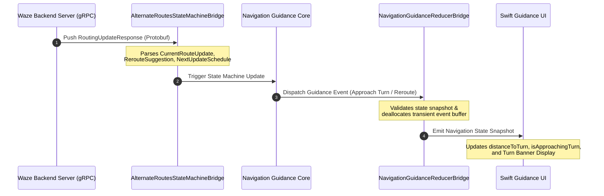
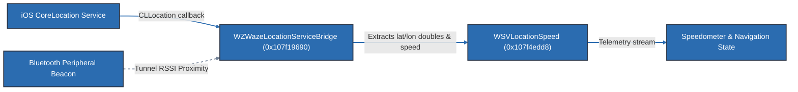

# Waze iOS Architecture & Subsystem Relationship Diagrams

This document contains Mermaid diagrams illustrating the architectural relationships, data flows, and subsystem boundaries discovered during static reverse engineering of Waze iOS v5.22.0.

> **Legend:**
> - Solid lines (`──>`) represent **VERIFIED** relationships confirmed through direct code references, method calls, or class metadata.
> - Dashed lines (`-.->`) represent **INFERRED** relationships based on architectural conventions and protocol structures.

---

## 1. Top-Level Subsystem Architecture

```mermaid
graph TD
    classDef verified fill:#2b6cb0,stroke:#2d3748,stroke-width:2px,color:#fff;
    classDef inferred fill:#718096,stroke:#2d3748,stroke-width:1px,stroke-dasharray: 5 5,color:#fff;
    classDef external fill:#4a5568,stroke:#2d3748,stroke-width:1px,color:#fff;

    subgraph UI_Layer ["Front-End Layer (Swift / SwiftUI / UIKit)"]
        UI_Root["Root View Controller"]:::verified
        UI_CarPlay["WZCarPlayMapController (0x107f17e30)"]:::verified
        UI_SwiftNav["WazeNavigationGuidance Module"]:::verified
    end

    subgraph Bridge_Layer ["Bridging & Reducer Layer (Objective-C++)"]
        B_Canvas["MainCanvasViewHolder (0x107f1a4a0)"]:::verified
        B_NavReducer["NavigationGuidanceReducerBridge (0x107f1ab08)"]:::verified
        B_AltRoutes["AlternateRoutesStateMachineBridge (0x107f17048)"]:::verified
        B_Location["WZWazeLocationServiceBridge (0x107f19690)"]:::verified
    end

    subgraph Core_Layer ["Core Logic & Engine Layer (C++)"]
        C_MetalRender["Metal Rendering Engine"]:::verified
        C_RoutingCore["Routing State & Maneuver Engine"]:::verified
        C_SpatialIndex["Spatial Tiling Engine"]:::inferred
    end

    subgraph Hardware_Layer ["iOS Frameworks & Hardware Services"]
        HW_Metal["Apple Metal Framework (default.metallib)"]:::external
        HW_GPS["CoreLocation Telemetry"]:::external
        HW_BT["CoreBluetooth (Tunnel Navigation)"]:::external
        HW_Net["gRPC Transport (roots.pem)"]:::external
    end

    UI_Root --> B_Canvas
    UI_CarPlay --> B_Canvas
    UI_SwiftNav --> B_NavReducer

    B_Canvas --> C_MetalRender
    B_NavReducer --> C_RoutingCore
    B_AltRoutes --> C_RoutingCore
    B_Location --> HW_GPS
    B_Location -.-> HW_BT

    C_MetalRender --> HW_Metal
    C_SpatialIndex -.-> HW_Metal
    C_RoutingCore --> HW_Net

    linkStyle 0,1,2,3,4,5,6,7,8,9 stroke:#2b6cb0,stroke-width:2px;
    linkStyle 10,11 stroke:#718096,stroke-width:2px,stroke-dasharray: 5 5;
```

---

## 2. Map Canvas Rendering Pipeline

```mermaid
flowchart TD
    classDef verified fill:#2b6cb0,stroke:#2d3748,stroke-width:2px,color:#fff;
    classDef inferred fill:#718096,stroke:#2d3748,stroke-width:1px,stroke-dasharray: 5 5,color:#fff;

    A["MainCanvasViewHolder.mm (0x107f1a4a0)"]:::verified -->|Calls createMetalViewController| B["MetalViewController"]:::verified
    B -->|Binds viewport & canvas size| C["CarPlayCanvasViewPortUtilities"]:::verified
    B -->|Loads compiled GPU shaders| D["default.metallib"]:::verified

    subgraph Shader_Pipelines ["Metal Shaders (default.metallib)"]
        D --> S1["BlurVertexShader / BlurFragmentShader"]:::verified
        D --> S2["SimpleTextureVertexShader / SimpleTextureFragmentShader"]:::verified
    end

    subgraph Vector_Tiling ["Vector Geometry & Styling"]
        E["TileLineStyle Layout Buffer"]:::verified
        E -->|progArgs.widths * kTileLineStyleCount| F["Rasterizer Pipeline"]:::verified
    end

    S2 --> F
    F -.-> G["GPU Display Surface (CAMetalLayer)"]:::inferred

    linkStyle 0,1,2,3,4,5,6,7 stroke:#2b6cb0,stroke-width:2px;
    linkStyle 8 stroke:#718096,stroke-width:2px,stroke-dasharray: 5 5;
```

---

## 3. Route Guidance & Reroute Event Pipeline



---

## 4. Location Telemetry & Speed Bridging


