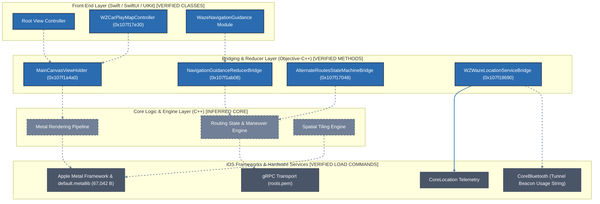
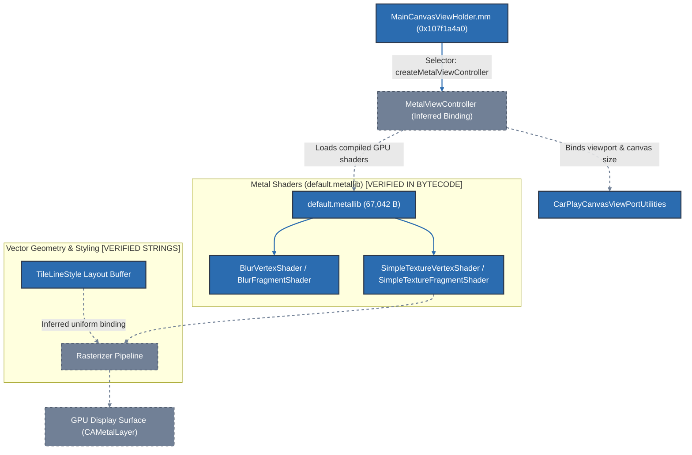
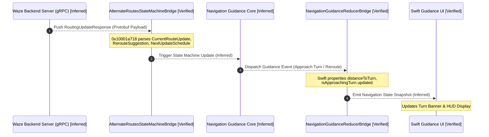
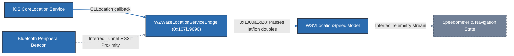

# Waze iOS Architecture & Subsystem Relationship Diagrams

This document contains Mermaid diagrams illustrating the architectural relationships, data flows, and subsystem boundaries discovered during static reverse engineering of Waze iOS v5.22.0.

> **Audit & Verification Legend:**
> - Solid lines (`──>`) represent **VERIFIED** relationships confirmed through direct code references, method calls, or class metadata.
> - Dashed lines (`-.->`) represent **INFERRED** relationships based on architectural conventions, error strings, and protocol structures.
> - All sequence diagrams represent inferred operational flows reconstructed from client parsing routines rather than live network packet captures.

---

## 1. Top-Level Subsystem Architecture

---

## 2. Map Canvas Rendering Pipeline

---

## 3. Route Guidance & Reroute Event Pipeline (Inferred Data Flow)

> *Note: This sequence illustrates the inferred control and data flow derived from parsing routines and error assertions in `AlternateRoutesStateMachineBridge::ParseToRoutingUpdateResponse` (`0x10001a718`). Live network messages were not dynamically captured.*

---

## 4. Location Telemetry & Speed Bridging

