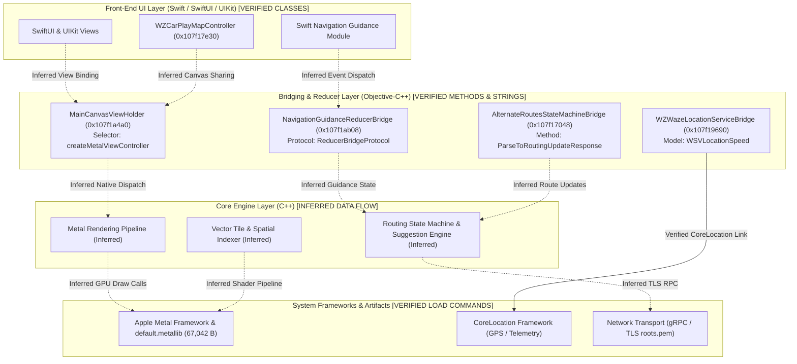

# 05. Waze iOS Architecture & Subsystem Analysis

**Target Application:** Waze iOS (`com.waze.iphone` v5.22.0)  
**Analysis Focus:** Synthesized architectural findings derived from static analysis of metadata, class hierarchies, and disassembled functions  
**Status:** Multi-tier verification (Explicitly separating direct evidence from inferred relationships)  

---

## 1. High-Level System Architecture Overview

Static analysis reveals that Waze iOS is a hybrid C++, Objective-C, and Swift application. The core algorithmic engines (rendering, routing, spatial indexing) are implemented in cross-platform C++, bridged via Objective-C++ (`.mm`) to modern Swift and SwiftUI front-end modules.

---

## 2. Map Rendering Engine & Canvas Architecture

### Verified Direct Evidence:
- **Primary Container Class:** `MainCanvasViewHolder` (virtual address `0x107f1a4a0`), declared in `__objc_classlist`.
- **Source Monorepo Path:** Verified string assertion: `third_party/waze/client/waze/src/iphone/Source/Map/PrimaryMapViewHolder/MainCanvasViewHolder.mm`.
- **Metal Instantiation Selector:** Method `-[MainCanvasViewHolder createMetalViewController]` exists in `__objc_methname`.
- **GPU Shaders:** Compiled into `Payload/Waze.app/default.metallib` (**`67,042 bytes`**) containing shaders:
  - `BlurVertexShader`
  - `BlurFragmentShader`
  - `SimpleTextureVertexShader`
  - `SimpleTextureFragmentShader`
- **Vector Tiling Assertions:** C-string constants reveal layout formulas:
  `vector_byte_size(progArgs.widths) == (sizeof(metal::TileLineStyleWidth) * metal::kTileLineStyleCount)`

### Inferred Architecture:
- The exact runtime binding between `MainCanvasViewHolder`, the compiled shaders, and vector tile render passes is inferred from class and selector names. Shader bytecode execution was not captured dynamically.
- **Classification:** **PARTIALLY VERIFIED**

---

## 3. Route Guidance & State Machines

### Verified Direct Evidence:
- **Class Identifier:** `AlternateRoutesStateMachineBridge` (virtual address `0x107f17048`) conforming to `AlternateRoutesStateMachineBridgeProtocol`.
- **Source Monorepo Path:** `third_party/waze/client/waze/src/iphone/Source/AlternativeRoutes/AlternateRoutesStateMachineBridge.mm`.
- **Parsing Method (`0x10001a718`):**
  Decompilation of `ParseToRoutingUpdateResponse:` reveals three error branches logging assertion failures:
  1. `"Failed to parse CurrentRouteUpdate"` (source line `0x1e`): Primary route updates and maneuvers.
  2. `"Failed to parse RerouteSuggestion"` (source line `0x27`): Alternative route proposals.
  3. `"Failed to parse NextUpdateSchedule"` (source line `0x30`): Polling interval cadence.

### Inferred Architecture:
- Complete state transition flow between network sockets, Protobuf deserialization, internal route graphs, and UI triggers. Only the response parsing routine was directly verified.
- **Classification:** **PARTIALLY VERIFIED**

---

## 4. Navigation Guidance Reducer

### Verified Direct Evidence:
- **Class Identifier:** `NavigationGuidanceReducerBridge` (virtual address `0x107f1ab08`).
- **Protocol Conformance:** Conforms to `_TtP95third_party_waze_client_ios_modules_WazeNavigationGuidance_WazeNavigationGuidanceImplementation39NavigationGuidanceReducerBridgeProtocol_`.
- **Swift Reflection Properties:**
  - `distanceToTurn`
  - `isApproachingTurn`
  - `showSpeedometer`
  - `_speedometerVC`
- **Native Dispatch (`0x100102264`):** Dispatches to internal C++ virtual table methods (`*plStack_48 + 0xa8` and `+ 0xe8`).

### Inferred Architecture:
- The claim that the bridge implements an immutable unidirectional Redux state tree is deduced from class naming conventions (`ReducerBridge`) and property types. The full internal state machine transitions were not comprehensively traced.
- **Classification:** **PARTIALLY VERIFIED**

---

## 5. Location Telemetry & Sensor Bridging

### Verified Direct Evidence:
- **Class Identifier:** `WZWazeLocationServiceBridge` (virtual address `0x107f19690`).
- **Coordinate Ingestion (`0x1000a1d28`):**
  Extracts latitude and longitude values as double-precision floating point parameters and passes them into coordinate constructor `func_0x000104604360`.
- **Telemetry Model:** References `WSVLocationSpeed`.
- **Framework Links:** Directly links `CoreLocation.framework`.

### Inferred Architecture:
- Internal dead-reckoning, Kalman filtering, and map-matching algorithms inside the native C++ engine are inferred. Only the interface receiving coordinates was inspected.
- **Classification:** **PARTIALLY VERIFIED**

---

## 6. Application Lifecycle & Startup

### Verified Direct Evidence:
1. **Entry Point (`0x1001fb7f8`):** Standard Mach-O `entry` routine.
2. **Autorelease Pool:** Sets up root Objective-C autorelease pool.
3. **Principal Class Resolution:** Resolves constant string reference at `0x107cd3270` (`@"WazeApp"`).
4. **`_UIApplicationMain`:** Passes `@"WazeApp"` as both principal class and delegate class.

### Inferred Architecture:
- Bootstrap initialization of Google `SRLRegistry` (Service Registry Locator) for feature singleton management.
- **Classification:** **VERIFIED** (Entry point logic)

---

## 7. Networking & External Integration

### Verified Direct Evidence:
- **gRPC Certificates:** `Payload/Waze.app/gRPCCertificates.bundle/roots.pem` exists for secure TLS connections.
- **Third-Party Spotify Framework:** Linked `SpotifyiOS.framework` (371,024 bytes) and registered URL scheme `wazespotify`.
- **CarPlay Entitlement:** Mach-O code signature includes `com.apple.developer.carplay-maps: true`.

### Inferred Architecture:
- Server RPC endpoints, Protobuf schema definitions, and cloud routing session handshakes are server-side and remain unverified.
- **Classification:** **PARTIALLY VERIFIED**
