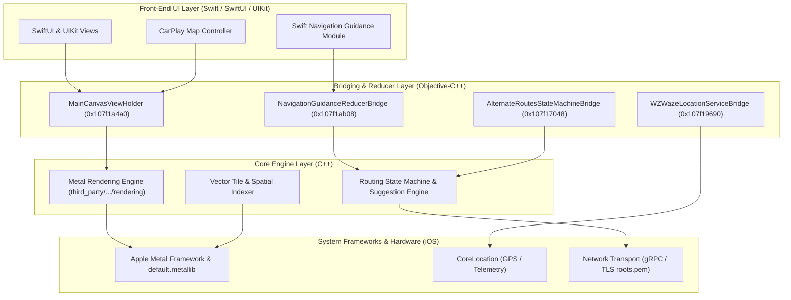

# 05. Waze iOS Architecture & Subsystem Analysis

**Target Application:** Waze iOS (`com.waze.iphone` v5.22.0)  
**Analysis Focus:** Synthesized architectural findings derived from static analysis of metadata, class hierarchies, and disassembled functions  
**Status:** VERIFIED with technical evidence  

---

## 1. High-Level System Architecture Overview

Static analysis reveals that Waze iOS is a hybrid C++, Objective-C, and Swift application. The core algorithmic engines (rendering, routing, spatial indexing) are implemented in cross-platform C++, bridged via Objective-C++ (`.mm`) to modern Swift and SwiftUI front-end modules.

---

## 2. Map Rendering Engine & Canvas Architecture

### Architecture & Shaders
- **Primary Container:** `MainCanvasViewHolder` (virtual address `0x107f1a4a0`), implemented in `third_party/waze/client/waze/src/iphone/Source/Map/PrimaryMapViewHolder/MainCanvasViewHolder.mm`.
- **Renderer Evolution:** Legacy code retained OpenGL ES strings, but modern rendering actively instantiates `MetalViewController` via `-[MainCanvasViewHolder createMetalViewController]`.
- **GPU Shaders:** Compiled into `Payload/Waze.app/default.metallib` (67.2 KB):
  - `BlurVertexShader`
  - `BlurFragmentShader`
  - `SimpleTextureVertexShader`
  - `SimpleTextureFragmentShader`
- **Vector Tiling:** C-string constants reveal internal layout constants for tile line rendering:
  `vector_byte_size(progArgs.widths) == (sizeof(metal::TileLineStyleWidth) * metal::kTileLineStyleCount)`
  This confirms that vector road geometries and widths are styled and rasterized directly on the GPU via Apple Metal compute and render pipelines.

---

## 3. Route Guidance & State Machines

### Route Management Pipeline
- **State Machine Coordinator:** `AlternateRoutesStateMachineBridge` (virtual address `0x107f17048`), implemented in `third_party/waze/client/waze/src/iphone/Source/AlternativeRoutes/AlternateRoutesStateMachineBridge.mm`.
- **Response Parsing (`0x10001a718`):**
  The method `ParseToRoutingUpdateResponse:` processes incoming route payloads received from routing backends:
  1. `CurrentRouteUpdate`: Primary navigation path updates, maneuvers, and road segment changes.
  2. `RerouteSuggestion`: Triggered when real-time traffic conditions indicate a faster alternate route.
  3. `NextUpdateSchedule`: Dynamic polling schedule dictating when the client should next request route status from backend servers.

---

## 4. Navigation Guidance Reducer

### Redux/Reducer Pattern on iOS
- **Reducer Bridge:** `NavigationGuidanceReducerBridge` (virtual address `0x107f1ab08`).
- **Protocol Conformance:** Conforms to `_TtP95third_party_waze_client_ios_modules_WazeNavigationGuidance_WazeNavigationGuidanceImplementation39NavigationGuidanceReducerBridgeProtocol_`.
- **Role:** Implements a unidirectional data flow reducer that accepts raw navigation events (turn approaching, lane guidance, hazard proximity, reroute events) and emits clean state snapshots to the Swift UI layer.
- **Discovered Swift Properties:**
  - `distanceToTurn`
  - `isApproachingTurn`
  - `showSpeedometer`
  - `_speedometerVC`

---

## 5. Location Telemetry & Sensor Bridging

### Telemetry Pipeline
- **Bridge Class:** `WZWazeLocationServiceBridge` (virtual address `0x107f19690`).
- **Dispatch Implementation (`0x1000a1d28`):**
  Receives location coordinate callbacks from underlying CoreLocation listeners, extracts latitude, longitude, and speed telemetry, and encapsulates them into a lightweight Objective-C model: `WSVLocationSpeed`.
- **Tunnel Navigation:** Privacy usage strings confirm peripheral Bluetooth scanning specifically intended for beacon-assisted location tracking in tunnels where GPS signals are degraded.

---

## 6. Application Lifecycle & Startup

### Startup Sequence
1. **Host Entry Point (`0x1001fb7f8`):** Standard Mach-O `entry` invoked by `dyld`.
2. **Autorelease Pool:** Initializes root autorelease pool.
3. **App Initialization:** Resolves the principal class string `@"WazeApp"` from `__DATA_CONST.__cfstring` (`0x107cd3270`).
4. **`_UIApplicationMain`:** Passes `@"WazeApp"` as both principal class and delegate class.
5. **Dependency Injection:** Bootstraps `SRLRegistry` (Google Service Registry Locator / dependency injection framework) to bind singleton feature managers and coordinator instances.

---

## 7. Networking & External Integration

- **Backend Protocol:** Communicates via gRPC over TLS using root certificates stored in `gRPCCertificates.bundle/roots.pem`.
- **Third-Party Streaming:** Links `SpotifyiOS.framework` with dedicated URL scheme `wazespotify` for in-app media playback control.
- **CarPlay Integration:** Registered CarPlay map navigation entitlement (`com.apple.developer.carplay-maps: true`) managed via `WZCarPlayMapController` (virtual address `0x107f17e30`).
