# 06. Reverse Engineering Feasibility & Recovery Assessment

**Target Application:** Waze iOS v5.22.0 (`com.waze.iphone`)  
**Assessment Objective:** Objectively evaluate the degree to which Waze's architecture and logic can be analyzed, understood, and replicated via clean-room, independent implementations.  
**Classification Categories:**
- **VERIFIED:** Confirmed with direct, incontrovertible technical evidence (headers, symbols, decompiled logic, strings).
- **PARTIALLY VERIFIED:** Architectural patterns identified with strong metadata evidence, but full behavior requires dynamic observation.
- **UNKNOWN:** Logic cannot be determined solely through static analysis without server traffic or runtime execution.
- **BLOCKED:** Direct analysis obstructed by host platform limitations or encryption constraints.

---

## 1. Subsystem Recovery Assessment Matrix

| Subsystem / Component | Assessment Status | Technical Findings & Evidence | Recovery / Rebuild Feasibility |
|---|---|---|---|
| **App Structure & Packaging** | **VERIFIED** | Canonical iOS bundle, 4 unencrypted Mach-O binaries, 29 modular feature bundles, 2 app extensions (`NotificationExtension`, `WazeShareExtension`). | **High:** App packaging, bundle layouts, and extension architectures can be recreated cleanly. |
| **UI Resources & Animations** | **PARTIALLY VERIFIED** | 75 Lottie `.json` animations and 58 `.nib` files extracted directly. 25 `.car` asset catalogs require macOS `assetutil` for complete image extraction. | **Moderate:** Lottie vector animations and layouts are usable; asset catalog textures need extraction on macOS. |
| **Swift & Obj-C Metadata** | **VERIFIED** | 6,994 Obj-C classes in `__objc_classname`, 5,677 mapped classes in `__objc_classlist`, 19,404 Swift reflection strings, complete method selector lists. | **Complete:** Full class signatures, protocols, and property names can be dumped and mapped. |
| **ARM64 Native Functions** | **VERIFIED** | Private function symbols are stripped, but functions can be created at exact method addresses and decompiled on demand via Ghidra/REA. | **High:** Disassembly and C pseudocode generation are 100% operational for targeted components. |
| **Map Rendering Pipeline** | **VERIFIED** | Apple Metal GPU pipeline confirmed via `default.metallib` shaders (`BlurVertexShader`, etc.) and `MainCanvasViewHolder.createMetalViewController`. | **Independent Re-implementation Feasible:** Custom Metal or MapLibre renderer can substitute the proprietary vector engine. |
| **Navigation State Logic** | **PARTIALLY VERIFIED** | State machine coordinators (`AlternateRoutesStateMachineBridge`) and guidance reducers (`NavigationGuidanceReducerBridge`) mapped. | **High for State Machine; Unknown for Core Math:** Client state transitions are clear; internal geometry matching is in C++ core. |
| **Route Pathfinding** | **UNKNOWN (Server-Dependent)** | Client parses route updates (`CurrentRouteUpdate`, `RerouteSuggestion`) from backend; pathfinding algorithms run remotely. | **Server-Dependent:** Any independent implementation must supply its own routing server (e.g., OSRM, Valhalla) or use public routing APIs. |
| **Search Subsystem** | **PARTIALLY VERIFIED** | Search interfaces (`CarPlaySearchResultsEventSender`, `waze_WazeSearchImplementation.bundle`, Lottie animation states) identified. | **Server-Dependent:** Client UI states are verified; backend query endpoints require network traffic auditing. |
| **ETA & Distance Tracking** | **VERIFIED** | Swift reflection properties (`distanceToTurn`, `isApproachingTurn`) and telemetry models (`WSVLocationSpeed`) verified. | **High:** Local distance decrementation and speed display can be replicated independently. |

---

## 2. Server vs. Local Architecture Boundary

Static analysis firmly confirms the architectural boundary between client and backend:

```mermaid
graph LR
    subgraph Client_Responsibilities ["Client Application (iOS / Local)"]
        direction TB
        C1["GPS Telemetry Filtering (WSVLocationSpeed)"]
        C2["Map Rendering (Apple Metal Shaders)"]
        C3["Navigation Guidance State Machine (NavigationGuidanceReducerBridge)"]
        C4["Turn-by-turn Voice Prompts & HUD"]
        C5["Alternative Route State Display (AlternateRoutesStateMachineBridge)"]
    end

    subgraph Server_Responsibilities ["Backend Servers (Google / Waze Remote)"]
        direction TB
        S1["Global Graph Pathfinding & Turn Calculation"]
        S2["Live Traffic Incident Aggregation"]
        S3["Real-Time Reroute Suggestions"]
        S4["Tile Map Data Distribution"]
        S5["Search & Geocoding Index"]
    end

    Client_Responsibilities <== "gRPC / Protobuf over TLS" ==> Server_Responsibilities
```

---

## 3. Feasibility of an Independent Prototype

### What CAN Be Clean-Room Re-Implemented:
1. **Application Shell & Navigation UI:** SwiftUI / UIKit navigation flows matching Waze's modular state reducer model.
2. **Telemetry & Sensor Engine:** GPS coordinate ingestion and speed calculation matching `WSVLocationSpeed`.
3. **Map Canvas:** Metal or MapLibre vector map rendering using standard vector tiles.
4. **Guidance State Machine:** Client-side approaching-turn alerts, lane guidance prompts, and distance countdowns based on route coordinates.
5. **CarPlay Extension:** Native iOS CarPlay template integration using the verified entitlements.

### What CANNOT Be Reconstructed from Static Analysis Alone:
1. **Proprietary Traffic Graph Algorithms:** Real-time crowd-sourced traffic routing takes place on backend server clusters.
2. **Backend Authentication & APIs:** Private gRPC service schemas require traffic capture with TLS decryption on a test device.

---

## 4. Hardware Verification Requirements

To advance beyond static analysis into live dynamic verification:
- **Jailbroken iOS Device or macOS Simulator:** Required to attach Frida, trace live Objective-C/Swift method invocations, and observe runtime state changes.
- **HTTP/gRPC Proxy Environment:** A configured interception proxy (mitmproxy or Charles) with custom root TLS certificates to capture backend request/response Protobuf payloads.
