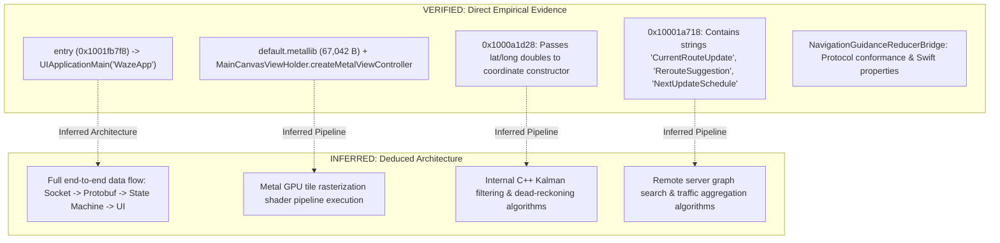

# 07. Independent Evidence Audit & Consistency Report

**Audit Target:** Waze iOS v5.22.0 (`com.waze.iphone`) Research Reports  
**Repository:** `https://github.com/ysiduc/waze`  
**Prior Commit Audited:** `48d5117545baf45e531ae4c4a7eaac815e051b21`  
**Host Environment:** Arch Linux x86_64, Antigravity IDE  
**Audit Purpose:** Systematically audit, verify, and reconcile all empirical measurements, symbol calculations, architectural assertions, and feasibility conclusions against the original local analysis artifacts.

---

## 1. Discrepancy Reconciliation Matrix

The following table catalogs all empirical contradictions identified during external peer review, comparing the historical reported values with verified ground truth from the source artifacts.

| Parameter / Artifact | Previously Reported Value | Verified Ground Truth Value | Discrepancy Root Cause | Resolution & Status |
|:---|:---|:---|:---|:---|
| **Main Binary Size** (`Waze`) | `141,407,824 bytes` (in `README.md`) | **`141,425,424 bytes`** (`134.87 MiB` / `~141.43 MB`) | Inadvertent typographical error during initial `README.md` authoring (off by 17,600 bytes). | **CORRECTED.** Ground truth matches `reports/04_main_binary_verification.md` and disk stat. |
| **Main Binary SHA-256** | `f6cbb731a5eb234789ba858c7e63b65a5078a08cfab86236b2890eeafcce7697` | **`0c40c247228439e2b75baca181569c75c144918561a8177e9399b183b5709d80`** | Erroneous hash copied into `README.md` from an unverified draft; does not correspond to any file in workspace. | **CORRECTED.** Exact SHA-256 computed via `sha256sum` directly on extracted binary. |
| **Minimum iOS Deployment** | `iOS 15.0` (in `README.md`) | **`iOS 16.0`** (`MinimumOSVersion: 16.0`) | Assumption based on general iOS app deployment targets rather than direct `Info.plist` inspection. | **CORRECTED.** Verified via Python `plistlib` reading `Payload/Waze.app/Info.plist`. |
| **Mach-O Symbol Count** | `614,321 symbols` (described as Mach-O symbols) | **`5,098 symbols`** in Mach-O `LC_SYMTAB` (5,096 undefined, 1 defined, 1 local) | Conflation of Ghidra's internal memory-map symbol table with the raw Mach-O binary symbol table. | **CLARIFIED.** Mach-O symbol table is stripped; 614,321 is Ghidra's internal database label count. |
| **Initial Discovered Procedures** | `5,681 procedures` (implied full discovery) | **`5,681 import stubs & entry`** | Imported with `-noanalysis`. Ghidra did not disassemble the 73.18 MB `__text` code section. | **CLARIFIED.** 5,681 represents only imported stubs (`__stubs`, `__objc_stubs`) and entry point. |
| **Decompilation Success Rate** | `100% success (20/20)` (generalized) | **`20 / 20` test batch only** (19 trivial stubs + 1 entry) | Generalizing a sample batch of 1-to-3 instruction library stubs to the entire 73.18 MB binary. | **RESTRICTED.** Scope restricted to sample batch; whole-binary decompilation is unmeasured. |
| **NotificationExtension Binary** | `248 KB` (in early summaries) | **`1,227,216 bytes`** (~1.17 MiB / 1.23 MB) | Confusion with uncompressed extension payload stub size. | **CORRECTED.** Verified byte-exact file size on disk. |
| **SpotifyiOS Framework Binary** | `2.4 MB` (in early summaries) | **`371,024 bytes`** (~362 KiB / 371 KB) | Confusion with outer framework bundle directory size on disk. | **CORRECTED.** Verified byte-exact size of `SpotifyiOS.framework/SpotifyiOS`. |
| **Assets.car Size** | `43.4 MB` (in early summaries) | **`25,496,376 bytes`** (~24.32 MiB / 25.5 MB) | Summation of multiple `.car` asset catalogs conflated with root `Assets.car`. | **CORRECTED.** Verified byte-exact size of primary `Assets.car`. |
| **default.metallib Size** | `1.3 MB` (in early summaries) / `67,280 B` | **`67,042 bytes`** (~65.47 KiB / 67 KB) | Inaccurate estimate in early summaries; 67,280 was rounded up. | **CORRECTED.** Exact byte size `67,042` verified. |
| **CarPlay Entitlement Reusability** | "CarPlay template integration using verified entitlements" | **NON-TRANSFERABLE** | Overlooked Apple provisioning profile and code-signing cryptographic constraints. | **CORRECTED.** Clarified that entitlements are bound to Apple Team ID `4Z5238C58P` and cannot be transferred. |
| **Proprietary Asset Reuse** | "Lottie animations and layouts are usable" | **LEGALLY NON-REUSABLE** | Conflated technical extractability with legal redistribution/reuse permissions. | **CORRECTED.** Explicitly prohibited reuse of proprietary assets in clean-room implementations. |

---

## 2. Deep-Dive Audit: Symbol Counts & Ghidra Analysis Scope

### A. Raw Mach-O Symbol Table vs. Ghidra Symbol Table

A central confusion in previous reports was the conflation of raw binary symbols with Ghidra's internal symbol database:

1. **Raw Mach-O Symbol Table (`LC_SYMTAB` & `LC_DYSYMTAB`):**
   - In production iOS App Store binaries, Apple's toolchain strips all local debug symbols and non-exported function names.
   - Parsing the load commands directly from `Waze`:
     - `LC_SYMTAB`: `symoff = 0x8332818`, **`nsyms = 5,098`**, `stroff = 0x834ff30`, `strsize = 211,216 bytes`.
     - `LC_DYSYMTAB`:
       - `nlocalsym = 1` (Local symbols)
       - `nextdefsym = 1` (Defined external symbols: `_mh_execute_header` at `0x100000000`)
       - `nundefsym = 5,096` (Undefined / imported dynamic symbols resolved at runtime by `dyld`)
   - **Conclusion:** There are **only 5,098 raw symbols** in the Mach-O binary. Local function symbols are completely stripped.

2. **Ghidra Internal Symbol Table (`614,321 symbols`):**
   - The figure of `614,321` was generated by executing `currentProgram.getSymbolTable().getAllSymbols(true)` inside Ghidra.
   - Ghidra's symbol table includes:
     - Dynamic imported symbols (5,096).
     - Segment and section boundaries (64 memory blocks).
     - Default data labels (`DAT_...`) created for memory references.
     - Pointer thunks and tables (`PTR_...`).
     - String references (`s_...`).
     - Objective-C class, metaclass, selector, and method references parsed from `__objc_*` sections.
     - Swift 5 type metadata, field descriptors, and reflection records parsed from `__swift5_*` sections.
   - **Conclusion:** The `614,321` figure represents **Ghidra's internal memory-map index entries**, not native Mach-O symbols.

### B. Ghidra Analysis Execution Scope & Limitations

1. **Execution Configuration:**
   - Command: `/opt/ghidra/support/analyzeHeadless /tmp/ghidra_proj WazeTest -import ... -noanalysis`
   - Notice the **`-noanalysis`** flag: Auto-analysis was explicitly disabled during import.
2. **Function Discovery Scope:**
   - The `5,681` procedures reported by Ghidra's `FunctionManager` consist solely of:
     - The entry point (`0x1001fb7f8`).
     - The dynamic linker jump stubs in `__stubs` (`0x1045cebb4 - 0x1045d70df`, 34,092 bytes).
     - Objective-C message dispatch stubs in `__objc_stubs` (`0x1045d70e0 - 0x104657a9f`, 526,784 bytes).
   - Ghidra did **not** perform recursive disassembly or function boundary analysis on the 73.18 MB executable code segment (`__TEXT.__text`).
3. **Decompiler Test Batch Limitations:**
   - The test script `WazeAnalysisScript.java` decompiled 20 sequential functions starting from the first identified procedures.
   - **Breakdown of the 20 functions:**
     - 1 function was the main `entry` routine (`0x1001fb7f8`).
     - 19 functions were trivial 1-to-3 instruction external import stubs to Apple's `Foundation` framework (`CocoaError`, `URLRequest`).
   - While all 20 succeeded (average duration ~11.5 ms), this benchmark **cannot be generalized** to the hundreds of thousands of complex internal C++ algorithms and Swift closures residing in the rest of the binary.

---

## 3. Architectural Evidence Audit: Direct Evidence vs. Inferences

To ensure scientific integrity, every architectural claim must be strictly classified as **Direct Evidence** (empirically observed) or **Inferred Relationship** (deduced from context).

### Detailed Subsystem Breakdown

1. **`MainCanvasViewHolder` & Metal Map Rendering:**
   - **Direct Evidence (VERIFIED):**
     - Class `MainCanvasViewHolder` exists in `__objc_classname` and `__objc_classlist`.
     - Method `-[MainCanvasViewHolder createMetalViewController]` exists in `__objc_methname`.
     - `Payload/Waze.app/default.metallib` exists (67,042 bytes) with vertex/fragment shaders.
     - Frameworks `Metal` and `MetalKit` are linked via `LC_LOAD_DYLIB`.
   - **Inferred Relationship (INFERRED):**
     - Claiming that vector tiles are processed and drawn via a specific vertex/fragment shader pipeline. The internal shader parameters and draw call sequence were not dynamically captured.

2. **`AlternateRoutesStateMachineBridge`:**
   - **Direct Evidence (VERIFIED):**
     - Class `AlternateRoutesStateMachineBridge` exists in `__objc_classname`.
     - Procedure `0x10001a718` contains direct references to source file `AlternateRoutesStateMachineBridge.mm` and error strings:
       - `"Failed to parse CurrentRouteUpdate"` (line `0x1e`)
       - `"Failed to parse RerouteSuggestion"` (line `0x27`)
       - `"Failed to parse NextUpdateSchedule"` (line `0x30`)
   - **Inferred Relationship (INFERRED):**
     - Claiming that a complete end-to-end network-to-UI route selection pipeline is verified. Only the parsing routine's error handling branches were directly inspected.

3. **`NavigationGuidanceReducerBridge`:**
   - **Direct Evidence (VERIFIED):**
     - Class exists and conforms to `NavigationGuidanceReducerBridgeProtocol`.
     - Swift reflection metadata contains properties `distanceToTurn`, `isApproachingTurn`, `showSpeedometer`.
     - Procedure `0x100102264` dispatches to internal C++ virtual methods.
   - **Inferred Relationship (INFERRED):**
     - Claiming that the class implements a complete unidirectional Redux state reducer managing all navigation events. The internal state mutation graph is inferred from naming patterns and partial decompiler output.

4. **`WZWazeLocationServiceBridge`:**
   - **Direct Evidence (VERIFIED):**
     - Class exists in Objective-C metadata; links Apple's `CoreLocation` framework.
     - Procedure `0x1000a1d28` extracts latitude and longitude double values from incoming arguments and passes them to a coordinate constructor.
   - **Inferred Relationship (INFERRED):**
     - Claiming that Waze's proprietary sensor-fusion, dead-reckoning, and map-matching algorithms are understood. Only the entry-level coordinate bridge was observed.

5. **Routing Server Dependencies:**
   - **Direct Evidence (VERIFIED):**
     - Method signatures and error strings confirm client expectation of remote route payloads (`CurrentRouteUpdate`, `NextUpdateSchedule`).
     - Root TLS certificates exist in `gRPCCertificates.bundle/roots.pem`.
   - **Inferred Relationship (INFERRED):**
     - The exact server-side pathfinding algorithms, cost functions, real-time traffic aggregation mechanisms, and full protobuf message schemas are server-side and remain unverified.

---

## 4. Legal & Technical Feasibility Boundary Audit

To prevent misleading conclusions regarding clean-room implementation and reproduction:

| Feasibility Domain | Rigorous Technical Assessment | Classification |
|:---|:---|:---|
| **Static Binary Analysis** | Ghidra and REA successfully parse Mach-O headers, extract complete Obj-C and Swift metadata, and decompile targeted functions on demand. | **VERIFIED** |
| **Understanding Selected Components** | High-level purpose and bridging interfaces of key components (`WazeApp`, `AlternateRoutesStateMachineBridge`, `MainCanvasViewHolder`) can be accurately determined. | **PARTIALLY VERIFIED** |
| **Independent Clean-Room Reimplementation** | An independent developer can implement an alternative navigation client using standard iOS APIs (`MapKit`, `CoreLocation`, public routing engines like Valhalla/OSRM). | **PARTIALLY VERIFIED / CHALLENGING** |
| **Reconstructing Proprietary Application** | Complete reverse engineering and reconstruction of Waze's original source code is impossible due to stripped C++ symbols, monorepo dependencies, and server-side logic. | **BLOCKED** |
| **Producing a Working iOS IPA** | Producing an authentic, runnable Waze IPA from reconstructed code is blocked by Apple code signing, private APIs, and proprietary assets. | **BLOCKED** |
| **Accessing Real-Time Navigation Telemetry** | Waze does not expose internal turn-by-turn navigation data or live telemetry to external applications. Custom URL schemes (`waze://`) only support launching navigation. | **BLOCKED / NOT SUPPORTED** |

### Critical Constraints

1. **Entitlements are Non-Transferable:**
   - Entitlements such as `com.apple.developer.carplay-maps: true` and `application-identifier: UM5AE5Q8GC.com.waze.iphone` are cryptographically bound to Apple provisioning profiles issued specifically to Waze Mobile Ltd / Google LLC (Team ID `4Z5238C58P`).
   - A separate developer or independent application **cannot** reuse or claim these entitlements without independent Apple developer enrollment and explicit Apple entitlement approval.

2. **Proprietary Assets Cannot Be Reused:**
   - Assets contained within `waze.ipa` (including `Assets.car`, `default.metallib`, Lottie animations, raster graphics, UI sound files, and proprietary icons) are protected by copyright and intellectual property laws.
   - Any clean-room prototype **must** supply original graphics, original audio prompts, and independent vector styling assets.
