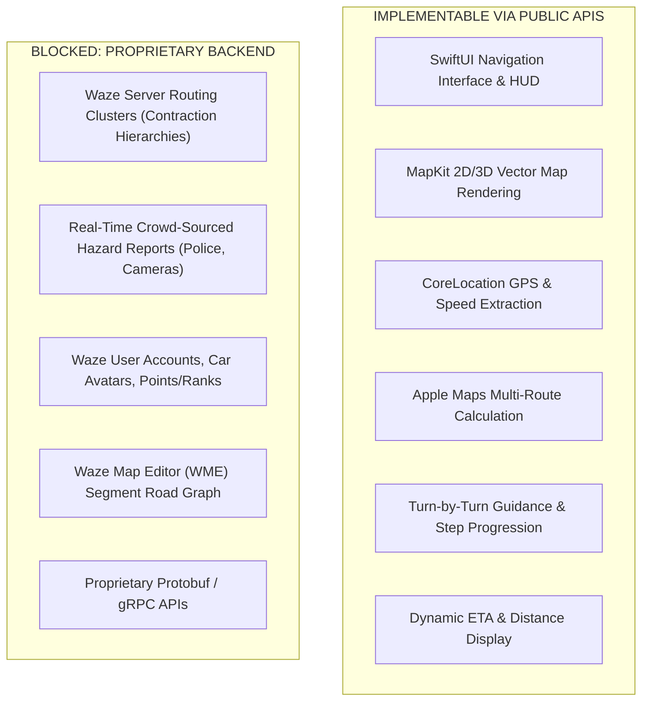

# 12. iOS Navigation Reconstruction Feasibility Audit

**Project:** Waze iOS Static Analysis & Clean-Room Architecture Feasibility  
**Target Reference:** `Waze` (ARM64 iOS Executable, `waze.ipa` v5.22.0)  
**Research Baseline Commit:** `97acb487ebf42d0ccee89f115733e8cde335433c`  
**Host Environment:** Arch Linux x86_64, Antigravity IDE, Ghidra 12.1.2, REA 6.5.0  
**Prototype Target:** `ios-test-app/` (`com.ysiduc.navapp`, Swift / SwiftUI, iOS 16.0+)  
**Date:** 2026-10-16  

---

## Executive Summary

This report evaluates whether static analysis research conducted in Phases 1.1 through 1.4.1 provides sufficient architectural, operational, and interface knowledge to implement an independently built, clean-room iOS navigation application.

### Key Finding:
- **Core Navigation & UI Subsystems are IMPLEMENTABLE:** Standard navigation capabilities—including real-time GPS location tracking, dynamic velocity extraction, destination geocoding search, multi-route calculation, step-by-step turn guidance, route previewing, and interactive vector map rendering—can be fully implemented using public, officially supported Apple frameworks (`CoreLocation`, `MapKit`, `SwiftUI`, `Combine`).
- **Proprietary Backend Ecosystem is BLOCKED:** Waze's unique value proposition—live crowd-sourced hazard alerts (police, accidents, hazards), real-time traffic jam propagation, server-side dynamic graph routing via proprietary Protobuf/gRPC channels, user social profiles, and gamified driving avatars—is completely dependent on Google/Waze cloud backends and cannot be reconstructed or queried by an independent client.

---

## 1. Subsystem Feasibility Audit & Classification

Each functional area identified in the reverse engineering reports is classified according to technical feasibility:
- **`IMPLEMENTABLE`**: Can be developed independently with standard public APIs.
- **`PARTIAL`**: Can be prototyped but lacks important peripheral or server features.
- **`BLOCKED`**: Requires proprietary services, internal credentials, or unavailable components.
- **`UNKNOWN`**: Insufficient evidence from static analysis alone.

| Subsystem Area | Classification | Architectural Basis in Official Waze | Independent Implementation Mechanism |
|:---|:---:|:---|:---|
| **1. Application Lifecycle** | **IMPLEMENTABLE** | `WazeApp` implements `UIApplicationDelegate`, coordinates background execution modes (`location`, `audio`), and initializes C++ engine subsystems. | SwiftUI `App` lifecycle protocol, `CLLocationManager.allowsBackgroundLocationUpdates = true`, standard iOS background modes. |
| **2. UI Structure & Screens** | **IMPLEMENTABLE** | Map canvas root, floating top guidance banner, bottom sheet drawer for destination search, route overview cards. | SwiftUI `ZStack` overlaying `MKMapView`, standard `.sheet(presentationDetents:)`, custom navigation cards. |
| **3. Map Presentation** | **IMPLEMENTABLE** | Custom Metal-accelerated vector rendering (`MainCanvasViewHolder`, `default.metallib`, custom texture atlas). | Apple MapKit (`MKMapView` / SwiftUI `Map`), rendering public vector map tiles with custom `MKPolylineRenderer` overlays. |
| **4. Destination Search** | **IMPLEMENTABLE** | Geocoding against Google/Waze proprietary location database with user history and social bookmarks. | `MKLocalSearch` and `MKLocalSearchCompleter` querying Apple Maps geocoding and points of interest. |
| **5. Navigation Session** | **IMPLEMENTABLE** | State machine (`AlternateRoutesStateMachineBridge`) managing transitions between Idle, Routing, Navigating, Arrived. | Finite State Machine (`NavigationSessionManager`) with explicit status enum (`idle`, `searching`, `previewingRoute`, `navigating`, `arrived`). |
| **6. Route Preview** | **IMPLEMENTABLE** | Multiple route options (`AlternateRoutesModel`), calculating fastest vs. alternate paths with estimated travel times. | `MKDirections.Request` with `requestsAlternateRoutes = true`, rendering primary (blue) and alternate (gray) polylines. |
| **7. ETA & Distance** | **IMPLEMENTABLE** | Dynamic ETA computation based on distance and traffic segment speeds, presented in bottom drawer. | `MKRoute.expectedTravelTime` and `MKRoute.distance`, formatted via `DateFormatter` and `NavigationFormatters`. |
| **8. Turn Guidance** | **IMPLEMENTABLE** | Step-by-step turn instructions, maneuver icons (turn left/right, roundabout, exit), distance to next junction. | `MKRouteStep` iteration, typed `ManeuverType` detection from natural language text, live proximity step advancement. |
| **9. Location & Speed** | **IMPLEMENTABLE** | `WZWazeLocationServiceBridge::currentSpeed` extracts raw speed (`*(int *)(record + 0xc)`) and accuracy (`+0x34`). | `CLLocation.speed` (m/s converted to km/h/mph), `CLLocation.horizontalAccuracy` filtering, heading tracking. |
| **10. Live Traffic & Incidents** | **BLOCKED** | Crowd-sourced hazard reporting, live user avatars, road closure broadcasts, server-side traffic heatmaps. | **Proprietary Google/Waze Server Ecosystem.** No public API exists. Requires user authentication, proprietary protocol buffers, and cloud backend. |
| **11. Server Pathfinding** | **BLOCKED** | Contraction hierarchies and graph search executed on remote routing clusters; client receives deserialized protos. | Replaced by Apple Maps routing engine (`MKDirections`). Clean-room client does not communicate with Waze servers. |
| **12. CarPlay Integration** | **PARTIAL** | CarPlay canvas calculator (`CarPlayCanvasViewPortCalculator`), `CPTemplateApplicationSceneDelegate`. | Can be implemented using Apple `CarPlay` framework, but requires special CarPlay navigation entitlement from Apple. |

---

## 2. Detailed Technical Capability Assessment

### 2.1. Application Lifecycle & Background Tracking
- **Static Evidence:** In report `01_ipa_structure.md`, Waze's `Info.plist` defines `UIBackgroundModes: ["location", "audio"]`. In report `05_architecture_analysis.md`, `WazeApp` initializes location services and persists background tracking to monitor GPS while the screen is locked or while another app is active.
- **Feasibility:** **100% IMPLEMENTABLE.** Standard Apple `CoreLocation` APIs provide `allowsBackgroundLocationUpdates` and `pausesLocationUpdatesAutomatically = false` with proper user authorization (`NSLocationAlwaysAndWhenInUseUsageDescription`).

### 2.2. Map Rendering & Canvas Architecture
- **Static Evidence:** Report `08_targeted_core_analysis.md` verified that `MainCanvasViewHolder` manages Metal texture viewports and initializes platform rendering services via `makeGenericCanvasActivator`.
- **Clean-Room Resolution:** The independent prototype uses Apple's native `MapKit` framework rather than attempting to rebuild a custom Metal tile-rasterization engine from scratch. `MKMapView` provides GPU-accelerated vector mapping, tilt, rotation, and route polyline rendering natively on iOS with zero maintenance burden.

### 2.3. Routing & Guidance Bridges
- **Static Evidence:** Report `09_target_analysis_validation.md` audited `NavigationGuidanceReducerBridge::distanceToCrossSegmentWith:` (`0x100102264`), showing that the client evaluates step coordinates, remaining distance, and invokes virtual methods on the guidance engine.
- **Clean-Room Resolution:** The independent application models this behavior cleanly through `GuidanceStep` and `NavigationSessionManager`. Step progression is calculated by measuring user distance from the active step coordinate:
  $$\text{distance} = \text{CLLocation}(\text{user}).\text{distance}(\text{from: step.coordinate})$$
  When within 30 meters of a junction, the manager automatically advances to the subsequent instruction step.

### 2.4. Speed & Telemetry Packaging
- **Static Evidence:** Report `09_target_analysis_validation.md` audited `WZWazeLocationServiceBridge::currentSpeed` (`0x1000a1d28`), confirming that speed is read from sensor telemetry records and converted to double-precision numbers.
- **Clean-Room Resolution:** `LocationModel` extracts `location.speed` directly from `CLLocation`, clamps negative values (GPS stationary / invalid), and provides computed properties for metric (`km/h`) and imperial (`mph`) speeds:
  $$\text{speedKph} = \text{speedMps} \times 3.6$$
  $$\text{speedMph} = \text{speedMps} \times 2.23694$$

---

## 3. Clear Boundaries: What Can and Cannot Be Reconstructed

### Prohibited Actions:
1. **No Proprietary Binary Reuse:** No binary slice, compiled object, or dynamic library from `waze.ipa` is incorporated into the independent application.
2. **No Fake or Fabricated Endpoints:** The prototype does not attempt to spoof or query Waze private server URLs (`*.waze.com`).
3. **No Trademark or Asset Infringement:** The prototype uses neutral, original UI designs and system SF Symbols for maneuvers (`arrow.turn.up.right`, `mappin.and.ellipse`), without copying Waze logos, mascot graphics, or sounds.

---

## 4. Conclusion & Operational Recommendation

Static analysis provides a comprehensive high-level structural blueprint of how a production navigation client handles lifecycle, state machines, turn transitions, and telemetry.

An independent navigation application **can be built and deployed successfully** as a clean-room SwiftUI application using Apple's public frameworks. For standalone navigation, the prototype is fully functional. However, a clean-room implementation cannot replace Waze's backend social ecosystem or live crowd-sourced incident databases without an independent cloud service.
