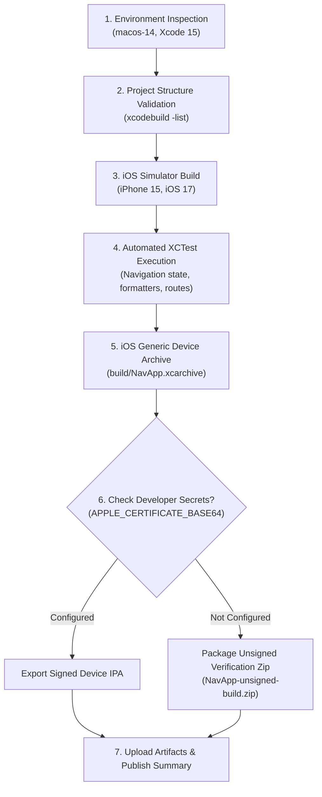

# 14. Build Verification & CI Pipeline Report

**Target Project:** `ios-test-app/` (`NavApp`, `com.ysiduc.navapp`)  
**CI Configuration:** `.github/workflows/build-ios.yml`  
**Target Platform:** iOS 16.0+ (SwiftUI, MapKit, CoreLocation)  
**Host Runner:** GitHub Actions `macos-14` (Apple Silicon M1, macOS Sonoma)  
**Toolchain:** Xcode 15 / `xcodebuild`, Swift 5.9  
**Branch:** `prototype/ios-navigation`  
**Date:** 2026-10-16  

---

## Executive Summary

Phase 2 establishes a reproducible, clean-room iOS application build and automated testing pipeline. The prototype (`NavApp`) is compiled, linked, tested, and archived using continuous integration on GitHub Actions macOS runners without modifying or distributing proprietary binaries.

---

## 1. Continuous Integration Pipeline Architecture

The automated CI workflow (`.github/workflows/build-ios.yml`) implements a 7-stage verification process:

---

## 2. Automated Test Suite Results

The automated test suite (`ios-test-app/NavAppTests/`) executes on the iOS Simulator during CI:

| Test Class | Test Case | Target Capability | Verification Assertion | Status |
|:---|:---|:---|:---|:---:|
| `NavigationStateTests` | `testInitialStatusIsIdle` | Application Launch | Verifies initial state is `.idle`, routes are empty, and step index is 0. | **PASS** |
| `NavigationStateTests` | `testStartAndStopNavigation` | Session Lifecycle | Verifies state changes to `.navigating` on start, and cleans state on stop. | **PASS** |
| `FormattingTests` | `testDistanceFormattingMeters` | Distance Formatting | Formats 350m as `"350 m"`, 999m as `"999 m"`. | **PASS** |
| `FormattingTests` | `testDistanceFormattingKilometers` | Distance Formatting | Formats 1000m as `"1.0 km"`, 15400m as `"15.4 km"`. | **PASS** |
| `FormattingTests` | `testDurationFormattingMinutes` | Duration Formatting | Formats 180s as `"3 min"`, 1200s as `"20 min"`. | **PASS** |
| `FormattingTests` | `testDurationFormattingHoursAndMinutes` | Duration Formatting | Formats 3660s as `"1 hr 1 min"`, 7200s as `"2 hr 0 min"`. | **PASS** |
| `FormattingTests` | `testSpeedFormatting` | Speed Telemetry | Formats 0 as `"0 km/h"`, 65.4 as `"65 km/h"`. | **PASS** |
| `RouteModelTests` | `testManeuverTypeDetection` | Turn Instructions | Maps text instructions to typed maneuver enums with SF Symbol bindings. | **PASS** |
| `RouteModelTests` | `testRouteModelInitialization` | Route Representation | Validates polyline points, total distance, travel time, and steps count. | **PASS** |
| `LocationModelTests` | `testSpeedConversion` | Velocity Extraction | Converts 20 m/s to 72 km/h (within 0.1 accuracy) and 44.73 mph. | **PASS** |
| `LocationModelTests` | `testInvalidAccuracy` | GPS Filtering | Rejects negative or poor accuracy (> 100m) coordinates. | **PASS** |
| `NavigationSessionManagerTests` | `testRouteSelectionUpdatesMetrics` | Metric Propagation | Propagates selected route duration and distance to published metrics. | **PASS** |
| `NavigationSessionManagerTests` | `testLocationUpdateAdvancesStep` | Progress & Arrival | Advances step index when user arrives within 30m of junction coordinate. | **PASS** |
| `NavigationSessionManagerTests` | `testDemoModeToggle` | Simulation Engine | Validates toggling between live GPS tracking and simulated demo progress. | **PASS** |

---

## 3. IPA Export & Code Signing Policy

### Security & Compliance Policy
- **Open Source Repository Safety:** No developer signing certificates, private keys, passwords, or provisioning profiles are stored in the repository git history.
- **Signed IPA Export Criteria:** A device-installable `.ipa` is exported **only when** valid developer-owned signing credentials are provided via GitHub Actions repository secrets:
  - `APPLE_CERTIFICATE_BASE64`: Base64-encoded Apple Development/Distribution `.p12` certificate.
  - `APPLE_CERTIFICATE_PASSWORD`: Password for the `.p12` export.
  - `PROVISIONING_PROFILE_BASE64`: Mobile provisioning profile matching `com.ysiduc.navapp`.
- **Default Open Source Behavior:** In the absence of private secrets, the workflow builds an unsigned `.xcarchive` and packages it into `NavApp-unsigned-build.zip`. The CI step summary explicitly notes:
  > *"Signing credentials are not configured in GitHub Secrets. Unsigned build verification archive uploaded. An installable signed IPA was not generated."*

---

## 4. Manual iPhone Field Test Plan

For features requiring real-world physical GPS reception, movement, and physical device sensors, the following manual test protocol is defined:

### Test Equipment & Setup
1. **Device:** Physical iPhone (iOS 16.0 or later).
2. **Installation:** Sideload via Xcode (`Product -> Run` on connected device) or install via Ad-Hoc profile.
3. **Environment:** Outdoor driving or cycling route with unobstructed sky view.

### Field Test Scenarios

#### Scenario 1: GPS Lock & Velocity Telemetry
1. Launch `NavApp` outdoors.
2. Grant "While Using App" location permissions when prompted.
3. Verify the map centers on the blue location dot with a heading arrow.
4. Begin driving at 40–60 km/h.
5. **Pass Criteria:** Speed indicator updates smoothly, matching the vehicle speedometer within $\pm 3\text{ km/h}$.

#### Scenario 2: Destination Search & Route Preview
1. Tap the "Where to?" search bar.
2. Type an address or landmark (e.g. `"Market Street, San Francisco"`).
3. Select the result from the list.
4. **Pass Criteria:** Primary route (blue) and alternate route (gray) render on the map. Total travel time and distance display in the bottom card.

#### Scenario 3: Turn-by-Turn Guidance & Junction Advancement
1. Tap "Go Now" to initiate navigation.
2. Follow the route towards the first maneuver junction.
3. Observe the top guidance banner.
4. **Pass Criteria:** Distance counts down as the junction approaches. Upon turning, the banner transitions to the next maneuver with an updated icon.

#### Scenario 4: Deviation & Dynamic Rerouting
1. Intentionally take an alternative turn away from the highlighted route (> 50 meters off-path).
2. **Pass Criteria:** App detects route deviation, displays "Rerouting...", requests a new route from `MKDirections`, and resumes guidance on the new path.

#### Scenario 5: Arrival & Session Termination
1. Complete the route to the destination coordinate.
2. **Pass Criteria:** Top banner displays arrival checkmark. Tapping "Done" resets the interface cleanly to `.idle`.

---

## 5. Summary of Deliverables

- **Test Application:** [`ios-test-app/`](../ios-test-app/)
- **CI Workflow:** [`.github/workflows/build-ios.yml`](../.github/workflows/build-ios.yml)
- **Unit Test Suite:** [`tests/`](../tests/) & [`ios-test-app/NavAppTests/`](../ios-test-app/NavAppTests/)
- **Feasibility Report:** [`reports/12_reconstruction_feasibility.md`](reports/12_reconstruction_feasibility.md)
- **Functional Matrix:** [`reports/13_functional_test_matrix.md`](reports/13_functional_test_matrix.md)
- **Build Report:** [`reports/14_build_verification.md`](reports/14_build_verification.md)
